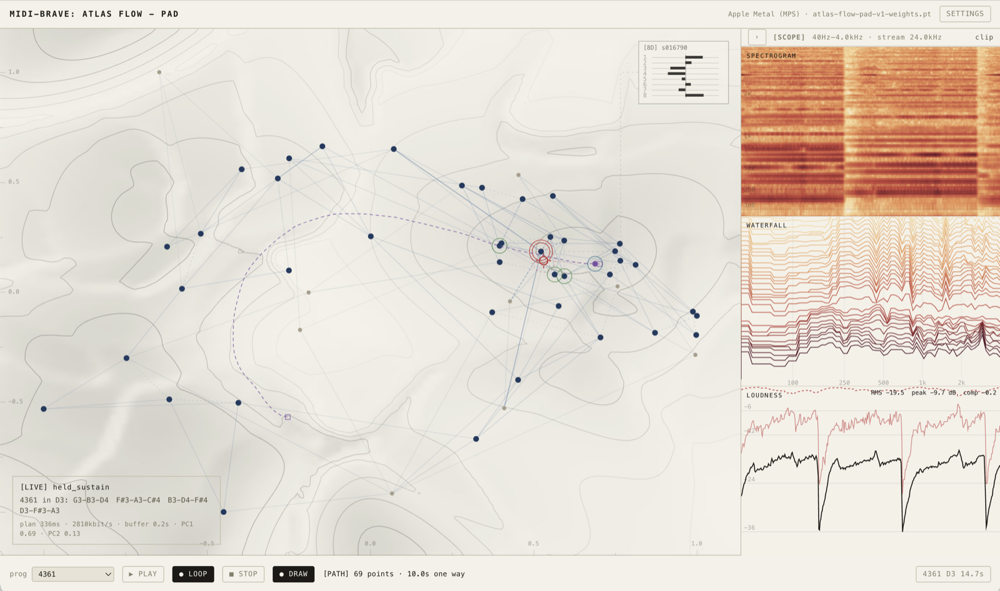
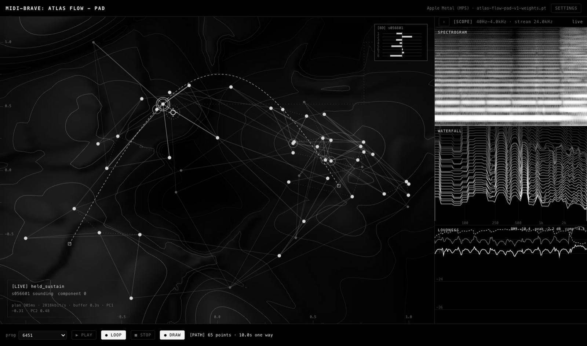

# MidiBrave

**Atlas Flow** turns a map of timbre into an instrument. Give it a fixed MIDI
sequence, draw a path across the map, and the sequence plays back with its
timbre following your path — continuously, within a note and not only between
notes. The model runs on the machine in front of you.

|  |  |
|---|---|
| <sub>The application UI. The atlas contains preset anchors as dots, their nearest-neighbour edges, and shading by how far a request at each point is projected before reaching the model.</sub> | <sub>The same UI in `Monochrome`, the default theme. A theme changes the palette and nothing else — same hairlines, same layout, same information.</sub> |

📄 **Paper** — *Atlas Flow: Explicit Timbre-Trajectory Modeling for a Navigable
Latent-Space Synthesizer*, ISMIR 2026 Late-Breaking Demo:
**[PDF](docs/paper/atlas-flow-ismir2026-lbd.pdf)** ·
[source and how to rebuild it](docs/paper/) ·
[all documentation](docs/)

The repository is named for the training framework underneath: a dual-branch,
MIDI-conditioned BRAVE. Atlas Flow is what that framework produced, and it is
what the rest of this page is about. Everything else lives in
[Research history](docs/research-history.md).

---

# User guide

## What it actually does

Most learned timbre spaces give you one latent vector per coordinate — a knob.
Move the knob and the timbre changes; hold still and it sits there. Atlas Flow
returns a **trajectory** per coordinate instead: five seconds of timbre motion,
one frame every 46.4 ms. So a held note keeps evolving without you touching
anything, and a path traced across the map becomes timbre automation for the
whole take.

The map itself is the interface. Each dot is one of **50 pad presets**, placed
by principal component analysis over the learned timbre space. Lines are a
nearest-neighbour graph measured in the full 8-D space, not in screen distance —
dashed edges are the pairs that lie about how close they are once flattened to
two dimensions, and that is usually where roaming jumps.

## Getting it

Download the build for your platform, unzip, and run it.

> Builds attached to CI runs are named `…-TEST-WEIGHTS-plays-noise`, and that is
> exactly what they do: CI has no access to the trained weights, so it builds
> against random ones to test the machinery. A real build is the same pipeline
> with `ATLAS_PACK_MODEL` pointed at `local-model/`.

| | |
|---|---|
| macOS (Apple silicon) | `AtlasFlow.app` — right-click → **Open** the first time. The build is unsigned, so a double-click gets refused with "unidentified developer"; opening it from the context menu once is enough, and macOS remembers. |
| Windows (x64) | `AtlasFlow.exe` inside the unzipped folder. SmartScreen will warn for the same reason: **More info → Run anyway**. Keep the folder together — the .exe needs the files beside it. |

It is about 1 GB unzipped, most of which is torch. The **first launch takes
30–60 seconds** while the model and its runtime are read off disk for the first
time; the window says so while it waits. Later launches take a few seconds.

Where it puts things:

| | macOS | Windows |
|---|---|---|
| Renders, takes, recordings | `~/Library/Application Support/AtlasFlow/model-cache` | `%APPDATA%\AtlasFlow\model-cache` |
| Launch log | `~/Library/Application Support/AtlasFlow/desktop.log` | `%APPDATA%\AtlasFlow\desktop.log` |

If the window says the server did not come up, that log is what to send.

It picks the fastest backend it finds: CUDA, then Metal, then CPU. CPU works —
measured on an M2 a five-second plan takes 578 ms on four CPU threads against
301 ms on Metal, and sustaining a note costs nothing either way, because the
runtime time-warps a plan it already has rather than generating continuously.

## The first two minutes

**Click the atlas to begin.** The first click starts audio — browsers and the
desktop shell alike will not make sound before a deliberate gesture. After that,
*moving the pointer is the audition*; there is nothing to hold down.

Then, in rough order of how much they change what you hear:

| | |
|---|---|
| **Move the pointer** | Roam. The voice morphs toward wherever you point, taking the nearest-neighbour graph to get there. The readout in the corner tells you what is sounding and how long the last plan took. |
| **`○ DRAW`, then drag** | Draw a path across the map. On release the timbre walks it, there and back, one lap every `lap` seconds. This is the thing the paper is about. |
| **`prog` + `▶ PLAY`** | Render a chord progression, written in scale degrees, with `pitch` as the tonic. Each chord is three separate voices summed — the model is monophonic. With a path drawn, each chord lands further along it. |
| **`○ LOOP`** | Splice the progression into a seamless loop, so you can keep roaming over it while it plays. |
| **`■ STOP`** | Everything: live voice, loop, clips, recording. |

The three panes on the right are scopes — spectrogram, waterfall, loudness by
default, each swappable in settings. They show what you are hearing right now,
not a rendering of the model's intentions.

## Settings worth knowing

Everything else is behind the one `SETTINGS` gear.

| | |
|---|---|
| **theme** | `Monochrome` (default), `Ember`, `Reef`, `Dusk`, `Paper (light)`. Monochrome is the only one that stays grey throughout; the other four use a real colormap where hue carries meaning. |
| **language** | 中文 and English, switchable live. |
| **pitch** | MIDI pitch of the live voice and the tonic of any progression. **The trained range is 36–71** and the slider will not leave it. |
| **morph** / **lap** | How long a move between points takes, and how long one pass along a drawn path takes. |
| **mode** | `prefetch` renders every preset up front, so hovering is instant but discrete. `live stream` roams continuously at the cost of bandwidth. Locally, live is the better default. |
| **buffer** | Buffer is latency *and* the margin against jitter. 0.3 s is enough on this machine. Raising it is the fix for dropouts, never lowering it. |
| **out rate** | `auto` follows the output device and forces nothing, so no stray resampling enters the chain. Set one by hand only if the probe is wrong — a virtual audio device, say. |
| **`● COMP`** | A multiband compressor on the output, with its own crossovers and makeup. |
| **`○ REC`** | Capture what you are hearing, compression included, as a take you can replay. |

## What it cannot do

Worth knowing before you judge the sound:

- **Pads only, 50 of them.** This is one timbre family from one trained atlas,
  not a general-purpose synthesiser.
- **Three octaves.** MIDI 36–71 is the trained range; outside it the model has
  never been asked for anything.
- **Velocity is output gain, nothing more.** It does not change the timbre. The
  runtime says so itself in its own status readout.
- **The model is monophonic.** Chords are N independent voices rendered and
  summed, which is why a four-note chord costs four times a single note.
- **Output is mono**, duplicated to both channels. There is no stereo image.

---

# Developer guide

## Running from a checkout

The same instrument without packaging, needing only Python:

```bash
python -m pip install torch soundfile numpy scipy aiohttp PyYAML
bash scripts/atlas_flow/fetch_local_model.sh    # once: 85 MB weights + atlas + evaluation
python -m midibrave.atlas_flow_local            # then: http://127.0.0.1:18796
```

`atlas_flow_local` is the cross-platform entry point and takes `--port`,
`--device`, `--model` and `--threads`; run it with `--help`. On Windows use it
directly — `local_demo.sh` is a thin bash convenience wrapper around it, nothing
more. **Set `PYTHONPATH=src` if the package is not installed**, or the module
will not be found.

To run the desktop shell against a checkout rather than a packaged build:

```bash
npm --prefix electron install
npm --prefix electron start
```

## How it works

Three learned parts, 22.2 M parameters in total.

| | | |
|---|---|---|
| **Encoder** | 0.63 M | Turns audio into a 128-dimensional trajectory, one frame per 46.4 ms. Used only during training, to manufacture targets — it is not in the shipped model. |
| **Flow predictor** | 13.5 M | A transformer that *generates* such a trajectory from a map coordinate, with conditional flow matching. It predicts a residual against a preset's anchor, so the map supplies which preset and the network supplies how the timbre moves inside it. It never sees MIDI. |
| **Decoder** | 7.9 M | A causal, PQMF-based decoder after BRAVE. MIDI enters here alone, as a FiLM condition at every residual block, alongside a phase-continuous harmonic excitation. |

Playing uses the flow predictor and the decoder. The encoder, the pitch
classifier and every training loss are absent.

A **plan** is the unit of work: the flow predictor samples a five-second
trajectory in autoregressive 64-frame blocks, and the decoder renders all five
seconds of audio in a single pass. Moving to a new point on the map costs one
plan. **Holding a note costs nothing** — the runtime time-warps the audio it
already rendered rather than generating continuously, which is why sustain is
free while morphing is not.

The training procedure — the three phases, the cross branch that forces pitch
out of the trajectory, the flow-matching objective — is described in
[the paper](docs/paper/atlas-flow-ismir2026-lbd.pdf), not here.

### Two consequences worth knowing before you extend it

Both follow from "the flow predictor never sees MIDI", and both are load-bearing
if you are thinking about polyphony, caching, or a plugin:

- **A trajectory is pitch-independent.** The same coordinate and seed produce a
  bit-identical trajectory at every note, so one trajectory can be cached and
  decoded at all 36 pitches. Note-on then costs a decode, not a plan.
- **`decode()` is separable from the planner.** It takes a trajectory, a note
  and a sample count, so audio rendering is reusable independently of the flow
  sampling that produced the trajectory.

## Repository layout

| | |
|---|---|
| `src/midibrave/atlas_flow_*.py` | The model, training, atlas, runtime and local server |
| `atlas-flow-web-demo/` | The instrument's front end — map, scopes, controls |
| `configs/atlas_flow/` | Atlas Flow training and runtime configuration |
| `electron/` | The desktop shell |
| `packaging/` | PyInstaller spec, entry point, smoke tests |
| `local-model/` | Weights (85 MiB), the 50-preset atlas, evaluation artifacts. Not in git |
| `docs/` | [Documentation](docs/), the [paper](docs/paper/), static assets |
| `scripts/` | Cluster jobs, data preparation, operational tooling |
| `tests/` | Test suite |

## Building the app

Both halves are built on the machine that will run them: the frozen server
contains native torch libraries, so a macOS host produces the macOS app and a
Windows host the Windows one. There is no cross-compiling.

```bash
python -m pip install torch soundfile numpy scipy aiohttp PyYAML pyinstaller
npm --prefix electron install
npm --prefix electron run build          # freeze the server, then package the app
```

`build` is the two steps together; run `build:server` and `pack` separately if
you are iterating on one of them. The result lands in `electron/dist/`.

By default the app is built around `local-model/`. Point it at a different set
of weights with `ATLAS_PACK_MODEL`:

```bash
ATLAS_PACK_MODEL=/path/to/weights npm --prefix electron run build
```

## Testing it

Two test suites, both of which CI runs on macOS and Windows:

```bash
python packaging/smoke_test.py --server build/pyi/atlas-flow-server/atlas-flow-server
node electron/smoke.js
```

The first exercises the frozen server: the atlas loads with all 50 presets, the
web assets are served from inside the bundle, a render produces audio that is
not silence, the same seed reproduces the same bytes, a three-note chord sums
three voices, and the live websocket negotiates a format and delivers PCM.

The second asks the narrower question only a packaged build can answer — is the
app actually self-contained? It runs the server from inside the app with no
`PYTHONPATH`, no virtualenv and the working directory set to the filesystem
root, so anything still reaching for the checkout fails there. It is pure Node
on purpose: a test that needed Python could not tell the difference.

To test without the trained weights — which is what CI does, since the real ones
live on a cluster no runner can reach:

```bash
python packaging/make_test_model.py --out build/test-model
ATLAS_PACK_MODEL=$PWD/build/test-model npm --prefix electron run build
```

That builds the same architecture from the same config with random parameters.
Everything downstream behaves identically and the audio is noise, which is the
point: it proves the machinery works on a platform without claiming anything
about how the model sounds.

## Continuous integration

`.github/workflows/atlas-flow-desktop.yml` builds and tests the desktop app on
macOS and Windows for every push to `main`, `v1` and `frontend`.

**Packaged apps are only uploaded on `workflow_dispatch` or a tag**, at 5-day
retention. This is deliberate and should stay that way: each run produces ~1.1 GB
of mostly-incompressible torch, and two such uploads once exceeded the
organisation's 500 MB shared-storage allowance, which blocked Actions across
every repository in the org — including this one, whose minutes are free because
it is public. To get installers, ask for them:

```bash
gh workflow run atlas-flow-desktop.yml --ref main
```

then download the artifacts promptly.

## Contributing

- Run both smoke suites before opening a pull request. They are what CI runs,
  so a green local run is a good predictor.
- The model, runtime and front end each have long explanatory comments about
  *why* something is the way it is — several encode a bug that was expensive to
  find. Read the comment before changing the line.
- Audio regressions are not visible in a diff. If you touch the runtime, say in
  the PR what you listened to.
- New documentation goes in [`docs/`](docs/); see its
  [index](docs/README.md) for where things belong.

## Documentation

| | |
|---|---|
| [The paper](docs/paper/) | ISMIR 2026 LBD extended abstract, with source and build instructions |
| [Documentation index](docs/README.md) | Everything else |
| [Research history](docs/research-history.md) | Earlier and parallel lines of work, kept for provenance. None of it is needed to run Atlas Flow |
